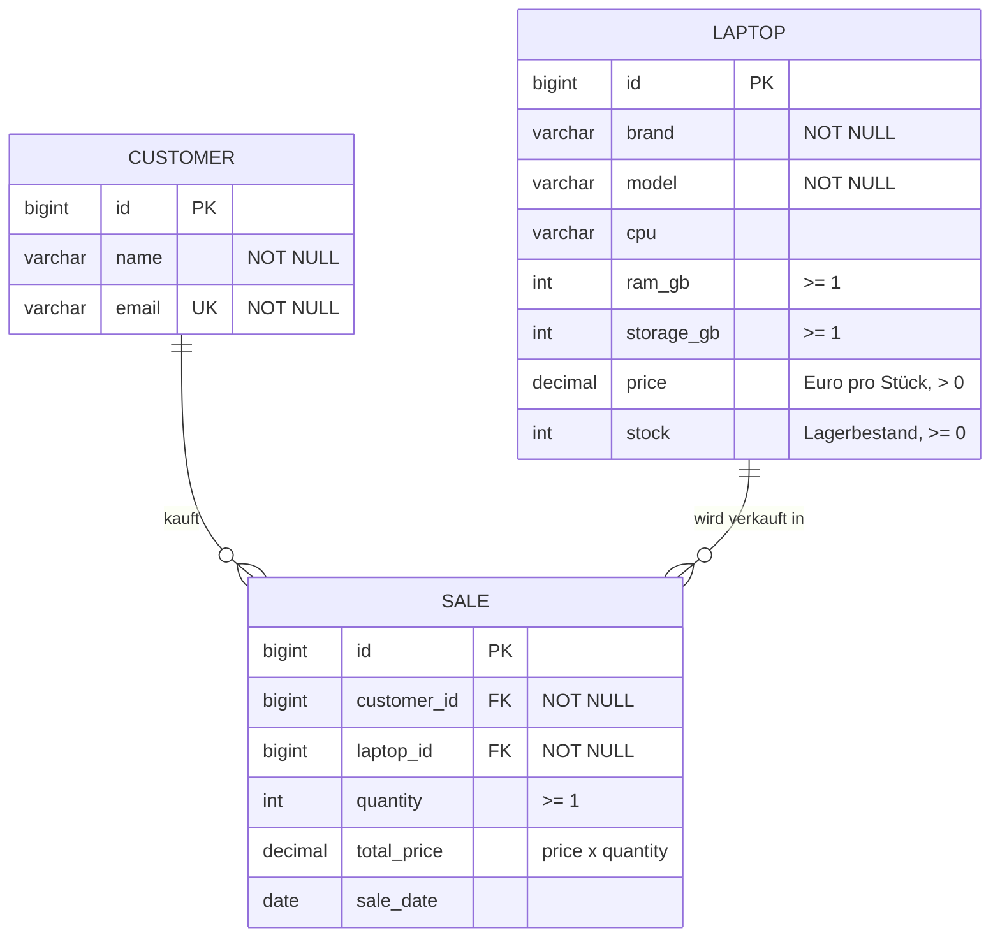

# Laptop-Verkauf – REST-Service mit Spring Boot und H2

[](https://github.com/LucaAcul2008/laptop-verkauf-rest-db/actions/workflows/build.yml)

Projekt „REST DB mit Spring Boot“ · HTL Saalfelden · Team: Luca Aigner & _Jonathan Rath_

> **KI-Kennzeichnung:** Dieses Projekt (Code, Tests und diese Dokumentation) wurde mit Unterstützung von
> **Claude (Anthropic, KI)** erstellt. Alle KI-generierten Inhalte sind hier und in der Präsentation
> gekennzeichnet. Siehe Abschnitt [KI-Nutzung](#6-ki-nutzung).

## Inhalt

1. [Projektbeschreibung und Motivation](#1-projektbeschreibung-und-motivation)
2. [Datenbank-Design](#2-datenbank-design)
3. [Entity, Repository, Service und Controller](#3-entity-repository-service-und-controller)
4. [Use Cases mit Testdaten](#4-use-cases-mit-testdaten)
5. [Zusammenfassung, Evaluierung und Erweiterungen](#5-zusammenfassung-evaluierung-und-erweiterungen)
6. [KI-Nutzung](#6-ki-nutzung)

## Starten

Voraussetzung: Java 21 und Maven.

```bash
mvn spring-boot:run
```

| Was | URL |
|---|---|
| Web-Oberfläche (Laptop-Shop) | http://localhost:5001/ |
| REST-API | http://localhost:5001/api/... |
| OpenAPI-Dashboard (Swagger UI) | http://localhost:5001/swagger-ui.html |
| OpenAPI-JSON | http://localhost:5001/v3/api-docs |
| H2-Konsole | http://localhost:5001/h2-console |

H2-Konsole Login: JDBC URL `jdbc:h2:mem:laptopdb`, User `sa`, Passwort leer.
Die Datenbank liegt nur im Arbeitsspeicher, nach jedem Neustart wird sie frisch mit den Testdaten befüllt.
Die Web-Oberfläche ist eine einzelne HTML-Datei (`src/main/resources/static/index.html`) ohne Build-Schritt, im Farbschema [Catppuccin](https://catppuccin.com/) (Latte hell, Macchiato dunkel, Umschalter oben rechts, Auswahl wird im Browser gemerkt). Sie ruft dieselbe REST-API per `fetch` auf. Fehlermeldungen der API (z. B. „Nicht genug auf Lager“) erscheinen dort als rote Meldung.
Fertige Beispielaufrufe liegen in [`requests.http`](requests.http) (IntelliJ / VS Code REST Client).

Tests: `mvn test`

**Tech Stack:** Java 21 · Spring Boot 3.5 (Web, Data JPA, Validation) · H2 In-Memory · springdoc-openapi (Swagger UI) · einfache Web-Oberfläche (HTML/JavaScript)

---

## 1. Projektbeschreibung und Motivation

Ein kleiner Laptop-Händler muss wissen, welche Laptops er im Sortiment hat, wie viele davon auf Lager sind
und wer was gekauft hat. Dieser Service bildet das als REST-API ab:

* **Laptops** mit Marke, Modell, Ausstattung, Preis und Lagerbestand werden verwaltet.
* **Kunden** werden mit Name und E-Mail gespeichert.
* Ein **Verkauf** verbindet Kunde und Laptop. Beim Verkauf sinkt der Lagerbestand automatisch und der Gesamtpreis wird berechnet.
* Ist nicht genug auf Lager, wird der Verkauf abgelehnt. Eine Stornierung legt die Stücke wieder ins Lager.
* Laptops lassen sich nach Marke oder Höchstpreis filtern, und man sieht, welche Modelle fast ausverkauft sind.

**Motivation:** Verkaufssysteme begegnen uns überall (Webshops, Kassen, Warenwirtschaft). Das Thema ist leicht zu verstehen,
hat drei Tabellen mit einer echten n:m-Beziehung und eine kleine Geschäftslogik (Bestand, Preisberechnung).
Damit geht es über reines „CRUD auf einer Tabelle“ hinaus, bleibt aber für zwei Personen gut machbar.

---

## 2. Datenbank-Design

Drei Tabellen. Die Tabelle `SALE` löst die n:m-Beziehung zwischen Kunden und Laptops auf: Ein Kunde kauft viele Laptops,
ein Laptop wird an viele Kunden verkauft. Die Tabellen erzeugt Hibernate automatisch aus den Entity-Klassen.



**Erklärung**

| Beziehung | Bedeutung |
|---|---|
| `CUSTOMER 1 : n SALE` | Ein Kunde hat viele Käufe, jeder Kauf gehört einem Kunden (`customer_id`). |
| `LAPTOP 1 : n SALE` | Ein Laptop kommt in vielen Verkäufen vor, jeder Verkauf betrifft einen Laptop (`laptop_id`). |
| `CUSTOMER n : m LAPTOP` | Ergibt sich über `SALE` als Zwischentabelle. |

`total_price` wird beim Verkauf gespeichert. So bleibt der Verkaufspreis erhalten, auch wenn der Laptop später im Preis geändert wird.

Regeln, die in der Datenbank und im Service gelten:

* Die E-Mail eines Kunden ist eindeutig (`UNIQUE`).
* Pflichtfelder sind `NOT NULL`, Preis muss positiv sein, der Bestand nie negativ (Bean Validation).
* Ein Laptop mit Verkäufen und ein Kunde mit Käufen kann nicht gelöscht werden (HTTP 409), damit keine Fremdschlüssel ins Leere zeigen.

---

## 3. Entity, Repository, Service und Controller

Die Schichten bauen aufeinander auf. Eine Anfrage läuft immer von oben nach unten:

```
HTTP-Request → Controller → Service → Repository → H2-Datenbank
```

Paketstruktur:

```
src/main/java/laptopshop
├── LaptopShopApp.java          Startklasse (@SpringBootApplication)
├── entity/                     Laptop, Customer, Sale
├── repository/                 je ein Spring-Data-Interface pro Entity
├── service/                    Geschäftslogik + eigene Exceptions
├── controller/                 REST-Endpunkte + ApiExceptionHandler
└── config/TestDataLoader.java  Testdaten beim Start
```

### Entity (Datenmodell)

Eine Entity ist eine Java-Klasse mit `@Entity`, die einer Tabelle entspricht. Jedes Feld wird zu einer Spalte.

```java
@Entity
public class Sale {
    @Id @GeneratedValue(strategy = GenerationType.IDENTITY)
    private Long id;                       // Primärschlüssel, von der DB hochgezählt

    @NotNull @ManyToOne(optional = false)
    @JoinColumn(name = "customer_id")      // Fremdschlüssel-Spalte zum Kunden
    private Customer customer;

    @NotNull @ManyToOne(optional = false)
    @JoinColumn(name = "laptop_id")        // Fremdschlüssel-Spalte zum Laptop
    private Laptop laptop;

    @Min(1) private int quantity;
    private BigDecimal totalPrice;
    private LocalDate saleDate;
}
```

* `@ManyToOne` bildet die Beziehung zum Kunden bzw. Laptop ab. Die Tabelle mit dem Fremdschlüssel hat immer die `@ManyToOne`-Seite.
* `@NotBlank`, `@Min`, `@DecimalMin`, `@Email` sind Validierungsregeln. Verletzt ein Request sie, antwortet die API mit 400.
* Geld ist `BigDecimal` (nicht `double`), damit keine Rundungsfehler entstehen.

### Repository (Datenzugriff)

Die Repositories sind nur Interfaces. Spring Data erzeugt die Implementierung selbst und liefert `findAll`, `findById`, `save`, `delete` gratis.
Eigene Abfragen entstehen allein aus dem Methodennamen:

```java
public interface LaptopRepository extends JpaRepository<Laptop, Long> {
    List<Laptop> findByBrandIgnoreCase(String brand);
    List<Laptop> findByPriceLessThanEqual(BigDecimal maxPrice);
    List<Laptop> findByStockLessThan(int stock);      // "fast ausverkauft"
}
```

### Service (Geschäftslogik)

Der Service enthält die Regeln der Anwendung. Der Controller soll nur weiterreichen, die Datenbank soll nur speichern.
Das wichtigste Beispiel ist `SaleService.create`:

```java
@Transactional
public Sale create(Sale sale) {
    Customer customer = customerRepository.findById(cid).orElseThrow(...);   // 404, wenn Kunde fehlt
    Laptop laptop = laptopRepository.findById(lid).orElseThrow(...);         // 404, wenn Laptop fehlt
    if (laptop.getStock() < sale.getQuantity())
        throw new ConflictException("Nicht genug auf Lager ...");            // 409
    laptop.setStock(laptop.getStock() - sale.getQuantity());                 // Lager reduzieren
    sale.setTotalPrice(laptop.getPrice().multiply(BigDecimal.valueOf(sale.getQuantity())));
    return saleRepository.save(sale);
}
```

`@Transactional` sorgt dafür, dass „Verkauf speichern“ und „Bestand reduzieren“ zusammen gelingen oder zusammen scheitern.

### Controller (REST-Schnittstelle)

Der Controller nimmt HTTP-Requests an, ruft den Service auf und gibt JSON zurück. `@RestController` + `@RequestMapping("/api/...")` legt die Pfade fest.
Der `ApiExceptionHandler` (`@RestControllerAdvice`) übersetzt Fehler zentral in Statuscodes.

| Methode | Pfad | Zweck | Erfolg |
|---|---|---|---|
| GET | `/api/laptops` | alle Laptops | 200 |
| GET | `/api/laptops?brand=HP` | nach Marke filtern | 200 |
| GET | `/api/laptops?maxPrice=800` | Preis bis höchstens 800 € | 200 |
| GET | `/api/laptops?lowStockBelow=3` | Bestand unter 3 Stück | 200 |
| GET | `/api/laptops/{id}` | ein Laptop | 200 / 404 |
| POST | `/api/laptops` | Laptop anlegen | 201 |
| PUT | `/api/laptops/{id}` | Laptop ändern (Preis, Bestand ...) | 200 |
| DELETE | `/api/laptops/{id}` | Laptop löschen | 204 / 409 |
| GET | `/api/customers` | alle Kunden | 200 |
| GET | `/api/customers/{id}` | ein Kunde | 200 / 404 |
| GET | `/api/customers/{id}/sales` | Käufe eines Kunden | 200 |
| POST | `/api/customers` | Kunde anlegen | 201 / 409 |
| PUT | `/api/customers/{id}` | Kunde ändern | 200 |
| DELETE | `/api/customers/{id}` | Kunde löschen | 204 / 409 |
| GET | `/api/sales?customerId=1` | Verkäufe, optional pro Kunde oder `laptopId` | 200 |
| POST | `/api/sales` | Verkauf anlegen, Bestand sinkt | 201 / 409 |
| DELETE | `/api/sales/{id}` | Verkauf stornieren, Bestand steigt | 204 |

| Fehlerfall | Statuscode |
|---|---|
| Datensatz existiert nicht | 404 |
| Ungültige Eingabe (z. B. leerer Name, ungültige E-Mail) | 400 |
| Regel verletzt (zu wenig Bestand, doppelte E-Mail, Löschen trotz Verweisen) | 409 |

---

## 4. Use Cases mit Testdaten

Beim Start legt `TestDataLoader` diese Daten an (IDs werden ab 1 vergeben):

| Laptop | Marke | CPU | RAM / SSD | Preis | Bestand |
|---|---|---|---|---|---|
| 1 OmniBook X Flip 16 | HP | Intel Core Ultra 7 | 32 GB / 1024 GB | 1299,00 € | 5 |
| 2 Thin GF63 | MSI | Intel Core i5-12450H | 16 GB / 512 GB | 599,00 € | 2 |
| 3 ThinkPad E14 | Lenovo | AMD Ryzen 5 7535U | 16 GB / 512 GB | 749,00 € | 8 |
| 4 MacBook Air 13 M3 | Apple | Apple M3 | 16 GB / 512 GB | 1199,00 € | 1 |

| Kunde | E-Mail |
|---|---|
| 1 Anna Huber | anna.huber@example.com |
| 2 Max Gruber | max.gruber@example.com |
| 3 Sophie Berger | sophie.berger@example.com |

| Verkauf | Kunde | Laptop | Menge | Gesamtpreis | Datum |
|---|---|---|---|---|---|
| 1 | 1 Anna | 3 ThinkPad E14 | 1 | 749,00 € | 01.10.2026 |
| 2 | 2 Max | 2 Thin GF63 | 1 | 599,00 € | 05.10.2026 |

Der Bestand in der Laptop-Tabelle ist der aktuelle Stand nach diesen Verkäufen.
Alle Aufrufe lassen sich im Swagger-UI oder mit [`requests.http`](requests.http) ausprobieren.
Die Use Cases sind zusätzlich als automatisierte Tests in `LaptopShopApiTest` abgedeckt.

### UC 1 – Sortiment anzeigen

`GET /api/laptops` → **200 OK**, Liste mit den 4 Laptops.

### UC 2 – Nach Marke oder Preis filtern

* `GET /api/laptops?brand=hp` → **200 OK**, 1 Treffer (HP OmniBook). Groß/Kleinschreibung ist egal.
* `GET /api/laptops?maxPrice=800` → **200 OK**, 2 Treffer: MSI Thin GF63 (599 €) und Lenovo ThinkPad E14 (749 €).

### UC 3 – Fast ausverkaufte Modelle finden

`GET /api/laptops?lowStockBelow=3` → **200 OK**, 2 Treffer: MSI Thin GF63 (2 Stück) und MacBook Air (1 Stück). Das sind die Modelle, die nachbestellt werden sollten.

### UC 4 – Neuen Laptop und neuen Kunden anlegen

`POST /api/laptops`

```json
{ "brand": "Dell", "model": "XPS 13", "cpu": "Intel Core Ultra 5", "ramGb": 16, "storageGb": 512,
  "price": 1499.00, "stock": 10 }
```

→ **201 Created**, Antwort enthält die neue `id` (hier 5).

`POST /api/customers`

```json
{ "name": "Lena Moser", "email": "lena.moser@example.com" }
```

→ **201 Created**, `id` 4. Dieselbe E-Mail ein zweites Mal ergibt **409 Conflict**.

### UC 5 – Laptop verkaufen (Bestand sinkt, Preis wird berechnet)

`POST /api/sales`

```json
{ "quantity": 2, "saleDate": "2026-10-12", "customer": { "id": 4 }, "laptop": { "id": 5 } }
```

→ **201 Created**, `totalPrice` ist **2998.00** (2 x 1499,00 €). Danach zeigt `GET /api/laptops/5` den Bestand **8** (vorher 10).
Kunde und Laptop werden nur über ihre `id` angegeben.

### UC 6 – Verkauf scheitert, weil zu wenig auf Lager ist

`POST /api/sales`

```json
{ "quantity": 3, "customer": { "id": 1 }, "laptop": { "id": 4 } }
```

→ **409 Conflict**

```json
{ "error": "Nicht genug auf Lager: nur noch 1 Stück" }
```

Der Bestand des MacBook bleibt bei 1.

### UC 7 – Verkauf stornieren (Bestand steigt wieder)

`DELETE /api/sales/2` → **204 No Content**. Danach hat der MSI Thin GF63 wieder 3 statt 2 Stück auf Lager.

### UC 8 – Käufe eines Kunden und Fehlerfälle

| Aufruf | Ergebnis |
|---|---|
| `GET /api/customers/1/sales` | 200, 1 Kauf (ThinkPad E14) |
| `GET /api/laptops/99999` | 404, `{"error": "Laptop mit ID 99999 nicht gefunden"}` |
| `POST /api/customers` mit `{"name": "", "email": "kaputt"}` | 400, Fehlermeldung zu `name` und `email` |
| `DELETE /api/laptops/3` (wurde verkauft) | 409, Laptop bleibt erhalten |
| `DELETE /api/customers/1` (hat Käufe) | 409, Kunde bleibt erhalten |

### Daten in der H2-Konsole prüfen

In der H2-Konsole (`/h2-console`) lassen sich die Tabellen direkt abfragen, zum Beispiel der Umsatz je Kunde:

```sql
SELECT c.name, COUNT(s.id) AS kaeufe, SUM(s.total_price) AS umsatz
FROM customer c LEFT JOIN sale s ON s.customer_id = c.id
GROUP BY c.name
ORDER BY umsatz DESC;
```

---

## 5. Zusammenfassung, Evaluierung und Erweiterungen

**Zusammenfassung:** Der Service verwaltet Laptops, Kunden und Verkäufe über eine REST-API mit H2-In-Memory-Datenbank.
Die Schichten Entity, Repository, Service und Controller sind sauber getrennt. Bestandslogik, Preisberechnung, Fehlercodes
(400/404/409) und Löschschutz machen aus dem Projekt mehr als reines Speichern und Auslesen.

**Evaluierung**

| Positiv | Schwächen |
|---|---|
| Drei verknüpfte Tabellen, n:m über Zwischentabelle gelöst | Ein Verkauf enthält genau einen Laptop (kein Warenkorb mit mehreren Positionen) |
| Geschäftslogik mit `@Transactional` (Bestand bleibt konsistent) | Die Entities werden direkt als JSON verwendet (keine DTOs) |
| Zentrale, einheitliche Fehlerbehandlung | Keine Authentifizierung, jeder kann alles ändern |
| Swagger-UI und H2-Konsole zum schnellen Testen | H2 In-Memory: alle Daten sind nach dem Neustart weg |
| Automatisierte Tests, Build läuft bei jedem Push in GitHub Actions | Keine Paginierung bei großen Listen |

**Mögliche Erweiterungen**

* Bestellung mit mehreren Positionen (`ORDER` + `ORDER_ITEM`) statt einem Laptop pro Verkauf.
* Persistente Datenbank (MariaDB/PostgreSQL) statt H2, nur `application.properties` ändern.
* DTO-Klassen, damit die API-Antworten unabhängig vom Datenbankmodell bleiben.
* Kategorien (Gaming, Business, Convertible), Bilder und Beschreibung pro Laptop.
* Gebrauchtgeräte-Ankauf (Zustand, Ankaufspreis) und Umsatzstatistik pro Monat.
* Paginierung, Sortierung und Suche; Login mit Spring Security.
* Größeres Frontend (z. B. React oder Flutter) auf Basis der OpenAPI-Beschreibung. Die mitgelieferte Oberfläche ist nur eine einfache Demo.

---

## 6. KI-Nutzung

| Bereich | Von KI erzeugt | Anpassung / Prüfung durch das Team |
|---|---|---|
| Projektidee und Datenmodell | Umsetzung der Idee „Laptop-Verkauf“ durch Claude | Thema wird im Team abgestimmt (Likes auf den Projektvorschlägen) |
| Java-Code (Entities, Repositories, Services, Controller, Tests) und Web-Oberfläche (`index.html`) | Erstellt von Claude (Anthropic) | Vom Team vor der Abgabe zu lesen, auszuführen und zu verstehen |
| Diese Dokumentation und das ER-Diagramm | Erstellt von Claude (Anthropic) | Vom Team vor der Abgabe zu prüfen und zu ergänzen |
| Vorlage (Aufbau von `task3-rest-patient-service`) | Von der Lehrkraft vorgegeben | – |

Hinweis: Die Tabelle ist vor der Abgabe vom Team zu ergänzen, falls weitere KI-Hilfe genutzt wurde.
